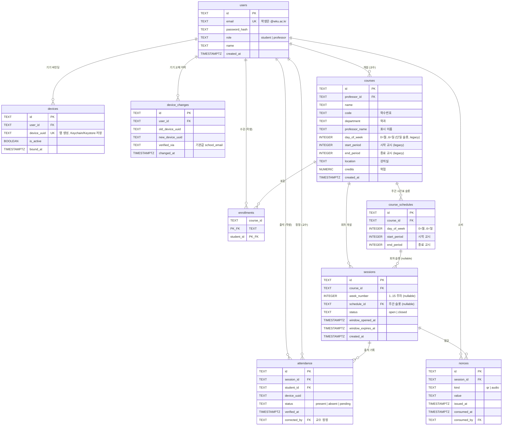

# Syncattend (SDAS) — 데이터베이스 스키마

이 문서는 `backend/app/models.py`(ORM), `backend/migrations/0001_initial_schema.sql`
(SQL), `contracts/openapi.yaml`(API 계약)과 항상 같은 내용을 유지합니다.

- **PostgreSQL**(운영) + **SQLite**(테스트) — 모든 ID와 기기 UUID는 이식성을 위해
  `TEXT`(36자 UUID 문자열)로 저장합니다. 앱이 `uuid4()` 문자열로 ID를 생성하므로
  네이티브 `UUID` 컬럼 대신 `TEXT`로 통일해 SQL과 ORM을 일치시켰습니다.
- **Redis** — 짧게 살고 사라지는 데이터 전용: 회전하는 QR/오디오 nonce(15초 TTL,
  1회용)와 기기 재등록 이메일 코드(TTL). 아래 `nonces` 표는 이미 소비된 nonce의
  **감사(audit) 기록**일 뿐입니다.

---

## 한눈에 보기 (초간단 그림)

계정 → 기기, 그리고 과목 → 주차별 수업 → 출석이 어떻게 이어지는지 보여줍니다.

```
          ┌─────────────┐
          │    users    │  학생 · 교수 계정
          └──────┬──────┘
       ┌─────────┼──────────────┬───────────────┐
       ▼         ▼              ▼               ▼
 ┌──────────┐ ┌──────────────┐ ┌──────────┐ ┌───────────────┐
 │ devices  │ │device_changes│ │ courses  │ │  enrollments  │
 │ 기기바인딩│ │ 기기교체이력  │ │ (교수)   │ │ 수강신청(N:M) │
 └──────────┘ └──────────────┘ └────┬─────┘ └───────────────┘
                            ┌────────┴─────────┐
                            ▼                  ▼
                  ┌──────────────────┐  ┌─────────────┐
                  │ course_schedules │  │  sessions   │  1주차·2주차···15주차
                  │ 주간 시간표 슬롯   │  │ week_number │  (수업 회차마다 1줄)
                  │ (월1교시,화1교시)  │◀─│ schedule_id │  회차가 어느 슬롯인지
                  └──────────────────┘  └──────┬──────┘
                                               │ 회차마다 출석기록
                                               ▼
                                        ┌─────────────┐
                                        │ attendance  │  present·absent·pending
                                        └─────────────┘
```

### "주차"는 어떻게 저장될까? (핵심 개념)

주차는 **따로 만든 표가 아니라, 수업 회차(`sessions`) 한 줄마다 붙는 숫자 라벨**
(`week_number`, 1~15)입니다. 교수가 수업을 열 때마다 `sessions`에 줄이 하나씩
쌓이고, 각 줄에 "몇 주차"인지 적힙니다.

```
sessions (자료구조 과목)                attendance (홍길동 학생)
┌────┬───────────┬─────────────┐        ┌────────────┬──────────┐
│ id │ course_id │ week_number │        │ session_id │  status  │
├────┼───────────┼─────────────┤        ├────────────┼──────────┤
│ s1 │  자료구조  │      1      │  ◀───  │     s1     │ present  │ 1주차 출석
│ s2 │  자료구조  │      2      │  ◀───  │     s2     │ absent   │ 2주차 결석
│ s3 │  자료구조  │      3      │  ◀───  │     s3     │ present  │ 3주차 출석
└────┴───────────┴─────────────┘        └────────────┴──────────┘
```

출석 기록은 회차(`session_id`)만 가리키면 되고, 몇 주차인지는
`attendance → sessions.week_number`를 따라가면 알 수 있습니다. 그래서 결석을
과목별로 세어 **2회=주의 / 3회=위험** 경고를 낼 수 있습니다.

### 주 여러 번 수업은? (course_schedules)

한 과목이 주 2회 이상 열릴 수 있습니다(예: A과목 = 월 1교시 + 화 1교시). 이를
위해 요일·교시 슬롯을 **`course_schedules`에 한 슬롯당 한 줄**로 저장합니다.
`courses`의 단일 `day_of_week`/`start_period`/`end_period` 칸은 레거시 호환용이며,
정규 시간표의 소스는 `course_schedules`입니다.

```
course_schedules (한 과목의 주간 슬롯들)          sessions (실제 열린 회차)
┌────┬───────────┬─────┬──────┬──────┐          ┌────┬──────────┬──────┬─────────────┐
│ id │ course_id │ 요일 │ 시작 │ 종료 │          │ id │ week_no  │ 요일 │ schedule_id │
├────┼───────────┼─────┼──────┼──────┤          ├────┼──────────┼──────┼─────────────┤
│ w1 │  A과목    │ 월  │  1   │  1   │  ◀─────  │ s1 │    3     │ (월) │     w1      │ 3주차 월 회차
│ w2 │  A과목    │ 화  │  1   │  1   │  ◀─────  │ s2 │    3     │ (화) │     w2      │ 3주차 화 회차
│ w3 │  B과목    │ 수  │  1   │  3   │          └────┴──────────┴──────┴─────────────┘
└────┴───────────┴─────┴──────┴──────┘          (B과목: 수 1~3교시 3시간 연속)
```

세션의 `schedule_id`가 "이 회차가 월 슬롯인지 화 슬롯인지"를 명확히 가리켜, 같은
3주차라도 월 회차와 화 회차를 데이터로 구분할 수 있습니다. `schedule_id`는
nullable이며, 슬롯이 삭제되어도(`ON DELETE SET NULL`) 세션과 출석은 보존됩니다.

---

## ER 다이어그램



---

## 테이블 설명

### `users` — 계정 (학생 · 교수)
| 컬럼 | 타입 | 설명 |
|------|------|------|
| id | TEXT PK | uuid4 문자열 |
| email | TEXT UNIQUE | 학생은 `@wku.ac.kr` |
| password_hash | TEXT | argon2 해시 |
| role | TEXT | CHECK `('student','professor')` |
| name | TEXT | 이름 |
| created_at | TIMESTAMPTZ | 기본값 `now()` |

### `devices` — 앱 생성 UUID 기기 바인딩 (신원 방어 축 1)
| 컬럼 | 타입 | 설명 |
|------|------|------|
| id | TEXT PK | |
| user_id | TEXT FK → users | `ON DELETE CASCADE` |
| device_uuid | TEXT **UNIQUE** | 앱이 생성, Keychain/Keystore 저장 |
| is_active | BOOLEAN | 기본값 true |
| bound_at | TIMESTAMPTZ | 바인딩 시각 |

- **`UNIQUE(device_uuid)`** = 하나의 UUID는 정확히 한 계정에만 속함.
- "계정당 활성 기기 1개", "UUID당 활성 바인딩 1개"는 앱 계층
  (`routers/devices.py`)에서 강제합니다. 재등록 시 `is_active=false` 행이 여러 개
  남기 때문에 DB 부분 유니크로는 처리하지 않습니다.
- 새/미지의 UUID는 바인딩 전에 반드시 `@wku.ac.kr` 이메일 재인증을 거칩니다.

### `device_changes` — 기기 교체 감사 (이상 탐지)
`old_device_uuid → new_device_uuid`, `verified_via`(기본 `school_email`),
`changed_at`. 릴레이/대여폰 악용을 추적하는 포렌식 기록입니다.

### `courses` — 과목 (+ 시간표 메타데이터)
| 컬럼 | 타입 | 설명 |
|------|------|------|
| id | TEXT PK | |
| professor_id | TEXT FK → users | 개설 교수 |
| name | TEXT | 과목명 |
| code | TEXT | 학수번호 (nullable) |
| department | TEXT | 학과명 (nullable) |
| professor_name | TEXT | 표시 이름 (nullable) |
| day_of_week | INTEGER | 0=월 .. 6=일, CHECK 0~6 (nullable, **legacy 단일 슬롯**) |
| start_period / end_period | INTEGER | 시작/종료 교시 (nullable, legacy) |
| location | TEXT | 강의실 (nullable) |
| credits | NUMERIC(3,1) | 학점 (nullable) |
| created_at | TIMESTAMPTZ | |

시간표 관련 단일 칸(day_of_week/start_period/end_period)은 레거시 호환용이며,
주 여러 번 수업은 아래 `course_schedules`가 정규 소스입니다.

### `course_schedules` — 주간 시간표 슬롯 (정규화)
| 컬럼 | 타입 | 설명 |
|------|------|------|
| id | TEXT PK | |
| course_id | TEXT FK → courses | `ON DELETE CASCADE` |
| day_of_week | INTEGER | 0=월 .. 6=일, CHECK 0~6 |
| start_period | INTEGER | 시작 교시, CHECK ≥1 |
| end_period | INTEGER | 종료 교시, CHECK ≥ start_period |

- 한 과목의 **주간 시간 슬롯 하나 = 한 줄**. 주 2회면 두 줄(월/화), 3시간 연속이면 한 줄(start~end).
- **`UNIQUE(course_id, day_of_week, start_period)`** — 같은 요일·시작 교시 슬롯 중복 방지.
- 반복 그룹 없이 1NF를 지키며, `courses`와 1:N으로 연결관계가 단순합니다.

### `enrollments` — 수강신청 (과목 ↔ 학생 N:M)
- 복합 기본키 `PRIMARY KEY(course_id, student_id)` — 중복 수강을 막고 과목과 학생
  사이의 N:M 관계를 표현합니다.

### `sessions` — 출석 세션 (교수가 여는 ~60초 인증 창, 주차별 회차)
| 컬럼 | 타입 | 설명 |
|------|------|------|
| id | TEXT PK | |
| course_id | TEXT FK → courses | |
| **week_number** | INTEGER | **1~15 주차, CHECK 제약, nullable(레거시 호환)** |
| schedule_id | TEXT FK → course_schedules | 어느 주간 슬롯 회차인지 (nullable, `ON DELETE SET NULL`) |
| status | TEXT | CHECK `('open','closed')` |
| window_opened_at | TIMESTAMPTZ | 인증 창 열린 시각 |
| window_expires_at | TIMESTAMPTZ | 인증 창 만료 시각 |
| created_at | TIMESTAMPTZ | |

- `week_number`로 "1주차 출석", "2주차 출석"처럼 주차별 출결을 기록·집계합니다.
- 인증 창은 `extendWindow`로 연장, `closeSession`으로 종료합니다.

### `attendance` — 출석 기록 (대리출석 최종 차단 지점)
| 컬럼 | 타입 | 설명 |
|------|------|------|
| id | TEXT PK | |
| session_id | TEXT FK → sessions | |
| student_id | TEXT FK → users | |
| device_uuid | TEXT | 인증에 사용된 UUID |
| status | TEXT | CHECK `('present','absent','pending')` |
| verified_at | TIMESTAMPTZ | 인증 시각 |
| corrected_by | TEXT FK → users | 교수 수동 정정 |

- **`UNIQUE(session_id, student_id)`** — 세션당 계정 1회 출석.
- **`UNIQUE(session_id, device_uuid)`** — 세션당 기기 1회 출석 (한 폰으로 여러 계정
  대리 출석 차단).

### `nonces` — 소비된 nonce 감사 기록 (선택)
회전 nonce 자체는 **Redis**(15초 TTL, 1회용)에 있습니다. 이 표는 소비된 nonce를
포렌식용으로 기록: `kind`(`qr`/`audio`), `value`, `issued_at`, `consumed_at`,
`consumed_by`, `UNIQUE(session_id, kind, value)`.

---

## 인덱스
`idx_devices_user(user_id)`, `idx_course_schedules_course(course_id)`,
`idx_sessions_course(course_id)`, `idx_attendance_session(session_id)`,
`idx_nonces_session(session_id)`.

## 다층 방어와 스키마 매핑

| 방어 계층 | 강제 위치 |
|-----------|-----------|
| 회전 QR 토큰 (15초 TTL, 1회용) | Redis (`nonces`에 감사) |
| 초음파 오디오 nonce (18–20 kHz) | Redis + `nonces` 감사 |
| 기기 UUID 바인딩 | `devices.UNIQUE(device_uuid)` |
| 세션당 계정/기기 1회 출석 | `attendance.UNIQUE(session_id, student_id)` + `UNIQUE(session_id, device_uuid)` |
| 교수 확인(professor-in-the-loop) | `attendance.corrected_by` |
| 기기 교체 / 이상 감사 | `device_changes` |
| 주차별 출결 · 과목별 결석 경고 | `sessions.week_number` + `attendance` 집계 |

## 저장소 분리
- **PostgreSQL** — 위 9개 영속 테이블 전체.
- **Redis** — 휘발성 단기 데이터: 회전 QR/오디오 nonce(15초 TTL, 1회용)와
  재등록 이메일 코드(TTL).
